# Icon catalog

Generated from Figma. Select an icon name to open its SVG.

| Preview | Icon | Collection | Artwork | Figma |
| --- | --- | --- | --- | --- |
|  | [Purview](./archive--686-155/purview--109-959.svg) | Archive | Vector | [Source](https://www.figma.com/design/Dc9hrEER6fgmrXVmOIImJT?node-id=109%3A959) |
|  | [Skype](./archive--686-155/skype--28-120294.svg) | Archive | Includes raster image | [Source](https://www.figma.com/design/Dc9hrEER6fgmrXVmOIImJT?node-id=28%3A120294) |
| 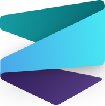 | [Syntex](./archive--686-155/syntex--504-12.svg) | Archive | Vector | [Source](https://www.figma.com/design/Dc9hrEER6fgmrXVmOIImJT?node-id=504%3A12) |
| 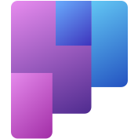 | [Tasks by Planner and To Do](./archive--686-155/tasks-by-planner-and-to-do--546-90.svg) | Archive | Vector | [Source](https://www.figma.com/design/Dc9hrEER6fgmrXVmOIImJT?node-id=546%3A90) |
| 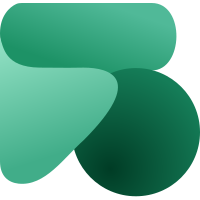 | [Viva Sales](./archive--686-155/viva-sales--3-3639.svg) | Archive | Vector | [Source](https://www.figma.com/design/Dc9hrEER6fgmrXVmOIImJT?node-id=3%3A3639) |
| 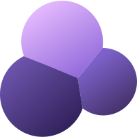 | [Viva Topics](./archive--686-155/viva-topics--3-3636.svg) | Archive | Vector | [Source](https://www.figma.com/design/Dc9hrEER6fgmrXVmOIImJT?node-id=3%3A3636) |
|  | [Yammer](./archive--686-155/yammer--28-120296.svg) | Archive | Vector | [Source](https://www.figma.com/design/Dc9hrEER6fgmrXVmOIImJT?node-id=28%3A120296) |
| 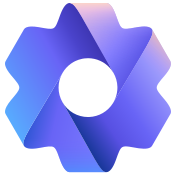 | [Admin](./icons--0-1/admin--108-211.svg) | Icons | Vector | [Source](https://www.figma.com/design/Dc9hrEER6fgmrXVmOIImJT?node-id=108%3A211) |
| 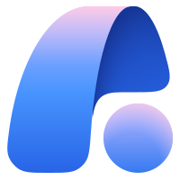 | [Agent 365](./icons--0-1/agent-365--2923-224.svg) | Icons | Vector | [Source](https://www.figma.com/design/Dc9hrEER6fgmrXVmOIImJT?node-id=2923%3A224) |
| 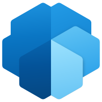 | [AIBuilder\_scalable](./icons--0-1/aibuilder-scalable--27-613.svg) | Icons | Vector | [Source](https://www.figma.com/design/Dc9hrEER6fgmrXVmOIImJT?node-id=27%3A613) |
| 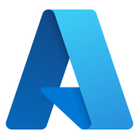 | [Azure](./icons--0-1/azure--108-241.svg) | Icons | Vector | [Source](https://www.figma.com/design/Dc9hrEER6fgmrXVmOIImJT?node-id=108%3A241) |
| 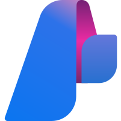 | [Azure AI Studio](./icons--0-1/azure-ai-studio--677-49.svg) | Icons | Vector | [Source](https://www.figma.com/design/Dc9hrEER6fgmrXVmOIImJT?node-id=677%3A49) |
|  | [Bing](./icons--0-1/bing--545-39.svg) | Icons | Vector | [Source](https://www.figma.com/design/Dc9hrEER6fgmrXVmOIImJT?node-id=545%3A39) |
| 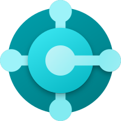 | [BusinessCentral\_scalable](./icons--0-1/businesscentral-scalable--28-120305.svg) | Icons | Vector | [Source](https://www.figma.com/design/Dc9hrEER6fgmrXVmOIImJT?node-id=28%3A120305) |
| 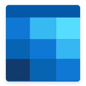 | [Calendar](./icons--0-1/calendar--116-1013.svg) | Icons | Vector | [Source](https://www.figma.com/design/Dc9hrEER6fgmrXVmOIImJT?node-id=116%3A1013) |
| 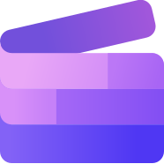 | [Clipchamp](./icons--0-1/clipchamp--692-3143.svg) | Icons | Vector | [Source](https://www.figma.com/design/Dc9hrEER6fgmrXVmOIImJT?node-id=692%3A3143) |
|  | [Commerce\_scalable](./icons--0-1/commerce-scalable--28-120304.svg) | Icons | Vector | [Source](https://www.figma.com/design/Dc9hrEER6fgmrXVmOIImJT?node-id=28%3A120304) |
|  | [Compliance](./icons--0-1/compliance--116-3136.svg) | Icons | Vector | [Source](https://www.figma.com/design/Dc9hrEER6fgmrXVmOIImJT?node-id=116%3A3136) |
| 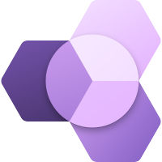 | [ConnectedStore\_scalable](./icons--0-1/connectedstore-scalable--28-120303.svg) | Icons | Vector | [Source](https://www.figma.com/design/Dc9hrEER6fgmrXVmOIImJT?node-id=28%3A120303) |
| 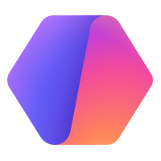 | [Copilot Agent Builder](./icons--0-1/copilot-agent-builder--2923-208.svg) | Icons | Vector | [Source](https://www.figma.com/design/Dc9hrEER6fgmrXVmOIImJT?node-id=2923%3A208) |
|  | [Copilot Cowork](./icons--0-1/copilot-cowork--2923-219.svg) | Icons | Vector | [Source](https://www.figma.com/design/Dc9hrEER6fgmrXVmOIImJT?node-id=2923%3A219) |
| 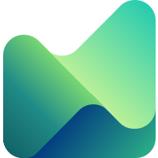 | [Copilot for Finance](./icons--0-1/copilot-for-finance--686-152.svg) | Icons | Vector | [Source](https://www.figma.com/design/Dc9hrEER6fgmrXVmOIImJT?node-id=686%3A152) |
| 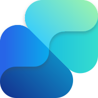 | [Copilot for Sales](./icons--0-1/copilot-for-sales--686-151.svg) | Icons | Vector | [Source](https://www.figma.com/design/Dc9hrEER6fgmrXVmOIImJT?node-id=686%3A151) |
|  | [Copilot for Security](./icons--0-1/copilot-for-security--686-154.svg) | Icons | Vector | [Source](https://www.figma.com/design/Dc9hrEER6fgmrXVmOIImJT?node-id=686%3A154) |
| 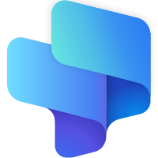 | [Copilot for Service](./icons--0-1/copilot-for-service--686-153.svg) | Icons | Vector | [Source](https://www.figma.com/design/Dc9hrEER6fgmrXVmOIImJT?node-id=686%3A153) |
| 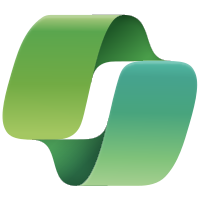 | [Copilot in Excel](./icons--0-1/copilot-in-excel--532-1603.svg) | Icons | Vector | [Source](https://www.figma.com/design/Dc9hrEER6fgmrXVmOIImJT?node-id=532%3A1603) |
| 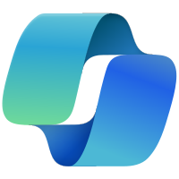 | [Copilot in Outlook / Word](./icons--0-1/copilot-in-outlook-word--532-1602.svg) | Icons | Vector | [Source](https://www.figma.com/design/Dc9hrEER6fgmrXVmOIImJT?node-id=532%3A1602) |
| 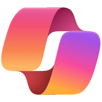 | [Copilot in PowerPoint](./icons--0-1/copilot-in-powerpoint--532-1604.svg) | Icons | Vector | [Source](https://www.figma.com/design/Dc9hrEER6fgmrXVmOIImJT?node-id=532%3A1604) |
| 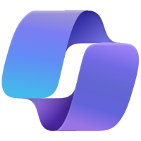 | [Copilot in Teams / OneNote / Loop](./icons--0-1/copilot-in-teams-onenote-loop--532-1601.svg) | Icons | Vector | [Source](https://www.figma.com/design/Dc9hrEER6fgmrXVmOIImJT?node-id=532%3A1601) |
|  | [Copilot Outline](./icons--0-1/copilot-outline--621-32.svg) | Icons | Vector | [Source](https://www.figma.com/design/Dc9hrEER6fgmrXVmOIImJT?node-id=621%3A32) |
|  | [Copilot Outline in Excel](./icons--0-1/copilot-outline-in-excel--546-319.svg) | Icons | Vector | [Source](https://www.figma.com/design/Dc9hrEER6fgmrXVmOIImJT?node-id=546%3A319) |
|  | [Copilot Outline in PowerPoint](./icons--0-1/copilot-outline-in-powerpoint--546-320.svg) | Icons | Vector | [Source](https://www.figma.com/design/Dc9hrEER6fgmrXVmOIImJT?node-id=546%3A320) |
|  | [Copilot Outline in Word](./icons--0-1/copilot-outline-in-word--546-280.svg) | Icons | Vector | [Source](https://www.figma.com/design/Dc9hrEER6fgmrXVmOIImJT?node-id=546%3A280) |
| 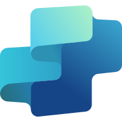 | [Copilot Studio](./icons--0-1/copilot-studio--532-1415.svg) | Icons | Vector | [Source](https://www.figma.com/design/Dc9hrEER6fgmrXVmOIImJT?node-id=532%3A1415) |
|  | [CoreHR\_scalable](./icons--0-1/corehr-scalable--28-120302.svg) | Icons | Vector | [Source](https://www.figma.com/design/Dc9hrEER6fgmrXVmOIImJT?node-id=28%3A120302) |
| 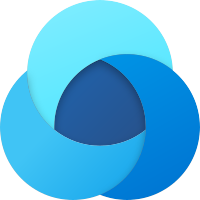 | [CustomerInsights\_scalable](./icons--0-1/customerinsights-scalable--28-120301.svg) | Icons | Vector | [Source](https://www.figma.com/design/Dc9hrEER6fgmrXVmOIImJT?node-id=28%3A120301) |
| 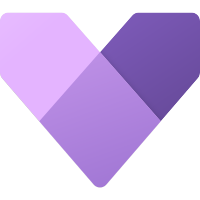 | [CustomerService\_scalable](./icons--0-1/customerservice-scalable--28-120325.svg) | Icons | Vector | [Source](https://www.figma.com/design/Dc9hrEER6fgmrXVmOIImJT?node-id=28%3A120325) |
|  | [CustomerServiceInsights\_scalable](./icons--0-1/customerserviceinsights-scalable--28-120324.svg) | Icons | Vector | [Source](https://www.figma.com/design/Dc9hrEER6fgmrXVmOIImJT?node-id=28%3A120324) |
| 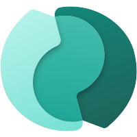 | [CustomerVoice\_scalable](./icons--0-1/customervoice-scalable--28-120323.svg) | Icons | Vector | [Source](https://www.figma.com/design/Dc9hrEER6fgmrXVmOIImJT?node-id=28%3A120323) |
| 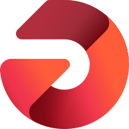 | [Data Activator](./icons--0-1/data-activator--694-3445.svg) | Icons | Vector | [Source](https://www.figma.com/design/Dc9hrEER6fgmrXVmOIImJT?node-id=694%3A3445) |
| 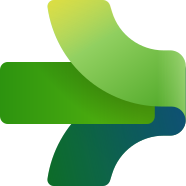 | [Data Factory](./icons--0-1/data-factory--694-3449.svg) | Icons | Vector | [Source](https://www.figma.com/design/Dc9hrEER6fgmrXVmOIImJT?node-id=694%3A3449) |
| 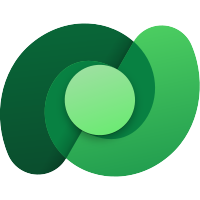 | [Dataverse\_scalable](./icons--0-1/dataverse-scalable--27-615.svg) | Icons | Vector | [Source](https://www.figma.com/design/Dc9hrEER6fgmrXVmOIImJT?node-id=27%3A615) |
|  | [Defender](./icons--0-1/defender--753-64.svg) | Icons | Vector | [Source](https://www.figma.com/design/Dc9hrEER6fgmrXVmOIImJT?node-id=753%3A64) |
| 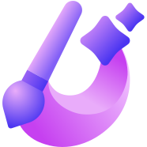 | [Designer](./icons--0-1/designer--690-3104.svg) | Icons | Vector | [Source](https://www.figma.com/design/Dc9hrEER6fgmrXVmOIImJT?node-id=690%3A3104) |
|  | [Dynamics365\_scalable 1](./icons--0-1/dynamics365-scalable-1--28-120300.svg) | Icons | Vector | [Source](https://www.figma.com/design/Dc9hrEER6fgmrXVmOIImJT?node-id=28%3A120300) |
| 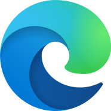 | [Edge](./icons--0-1/edge--690-3105.svg) | Icons | Vector | [Source](https://www.figma.com/design/Dc9hrEER6fgmrXVmOIImJT?node-id=690%3A3105) |
|  | [Entra](./icons--0-1/entra--114-987.svg) | Icons | Vector | [Source](https://www.figma.com/design/Dc9hrEER6fgmrXVmOIImJT?node-id=114%3A987) |
| 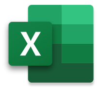 | [Excel](./icons--0-1/excel--28-120289.svg) | Icons | Includes raster image | [Source](https://www.figma.com/design/Dc9hrEER6fgmrXVmOIImJT?node-id=28%3A120289) |
|  | [Fabric](./icons--0-1/fabric--693-3292.svg) | Icons | Vector | [Source](https://www.figma.com/design/Dc9hrEER6fgmrXVmOIImJT?node-id=693%3A3292) |
|  | [FieldService\_scalable](./icons--0-1/fieldservice-scalable--28-120322.svg) | Icons | Vector | [Source](https://www.figma.com/design/Dc9hrEER6fgmrXVmOIImJT?node-id=28%3A120322) |
| 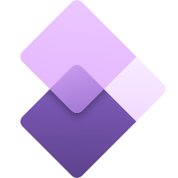 | [Finance+Operations\_scalable](./icons--0-1/finance-operations-scalable--28-120320.svg) | Icons | Vector | [Source](https://www.figma.com/design/Dc9hrEER6fgmrXVmOIImJT?node-id=28%3A120320) |
| 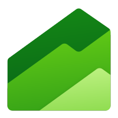 | [Finance\_scalable](./icons--0-1/finance-scalable--28-120321.svg) | Icons | Vector | [Source](https://www.figma.com/design/Dc9hrEER6fgmrXVmOIImJT?node-id=28%3A120321) |
| 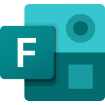 | [Forms](./icons--0-1/forms--108-171.svg) | Icons | Vector | [Source](https://www.figma.com/design/Dc9hrEER6fgmrXVmOIImJT?node-id=108%3A171) |
|  | [FraudProtection\_scalable](./icons--0-1/fraudprotection-scalable--28-120319.svg) | Icons | Vector | [Source](https://www.figma.com/design/Dc9hrEER6fgmrXVmOIImJT?node-id=28%3A120319) |
|  | [GitHub](./icons--0-1/github--734-2165.svg) | Icons | Vector | [Source](https://www.figma.com/design/Dc9hrEER6fgmrXVmOIImJT?node-id=734%3A2165) |
|  | [GitHub Copilot](./icons--0-1/github-copilot--734-60.svg) | Icons | Vector | [Source](https://www.figma.com/design/Dc9hrEER6fgmrXVmOIImJT?node-id=734%3A60) |
| 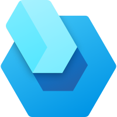 | [Guides\_scalable](./icons--0-1/guides-scalable--28-120327.svg) | Icons | Vector | [Source](https://www.figma.com/design/Dc9hrEER6fgmrXVmOIImJT?node-id=28%3A120327) |
| 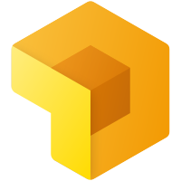 | [ImportTool\_scalable](./icons--0-1/importtool-scalable--28-120326.svg) | Icons | Vector | [Source](https://www.figma.com/design/Dc9hrEER6fgmrXVmOIImJT?node-id=28%3A120326) |
| 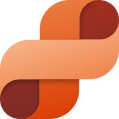 | [IntelligentOrderManagement\_scalable (1)](./icons--0-1/intelligentordermanagement-scalable-1--28-120318.svg) | Icons | Vector | [Source](https://www.figma.com/design/Dc9hrEER6fgmrXVmOIImJT?node-id=28%3A120318) |
| 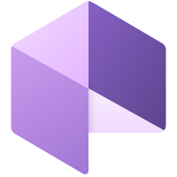 | [Layout\_scalable](./icons--0-1/layout-scalable--28-120332.svg) | Icons | Vector | [Source](https://www.figma.com/design/Dc9hrEER6fgmrXVmOIImJT?node-id=28%3A120332) |
| 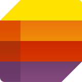 | [Lists](./icons--0-1/lists--28-120292.svg) | Icons | Vector | [Source](https://www.figma.com/design/Dc9hrEER6fgmrXVmOIImJT?node-id=28%3A120292) |
| 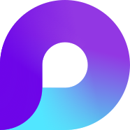 | [Loop](./icons--0-1/loop--690-3103.svg) | Icons | Vector | [Source](https://www.figma.com/design/Dc9hrEER6fgmrXVmOIImJT?node-id=690%3A3103) |
|  | [Marketing\_scalable](./icons--0-1/marketing-scalable--28-120317.svg) | Icons | Vector | [Source](https://www.figma.com/design/Dc9hrEER6fgmrXVmOIImJT?node-id=28%3A120317) |
| 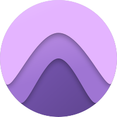 | [MarketInsights\_scalable](./icons--0-1/marketinsights-scalable--28-120316.svg) | Icons | Vector | [Source](https://www.figma.com/design/Dc9hrEER6fgmrXVmOIImJT?node-id=28%3A120316) |
| 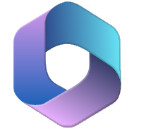 | [Microsoft 365](./icons--0-1/microsoft-365--103-57.svg) | Icons | Vector | [Source](https://www.figma.com/design/Dc9hrEER6fgmrXVmOIImJT?node-id=103%3A57) |
| 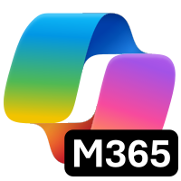 | [Microsoft 365 Copilot](./icons--0-1/microsoft-365-copilot--2702-184.svg) | Icons | Vector | [Source](https://www.figma.com/design/Dc9hrEER6fgmrXVmOIImJT?node-id=2702%3A184) |
| 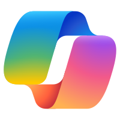 | [Microsoft 365 Copilot](./icons--0-1/microsoft-365-copilot--614-50.svg) | Icons | Vector | [Source](https://www.figma.com/design/Dc9hrEER6fgmrXVmOIImJT?node-id=614%3A50) |
| 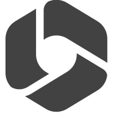 | [Microsoft 366\_B&amp;W](./icons--0-1/microsoft-366-b-w--690-3030.svg) | Icons | Vector | [Source](https://www.figma.com/design/Dc9hrEER6fgmrXVmOIImJT?node-id=690%3A3030) |
|  | [MRPortal\_scalable](./icons--0-1/mrportal-scalable--28-120331.svg) | Icons | Vector | [Source](https://www.figma.com/design/Dc9hrEER6fgmrXVmOIImJT?node-id=28%3A120331) |
|  | [New Outlook](./icons--0-1/new-outlook--546-213.svg) | Icons | Vector | [Source](https://www.figma.com/design/Dc9hrEER6fgmrXVmOIImJT?node-id=546%3A213) |
| 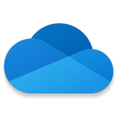 | [OneDrive](./icons--0-1/onedrive--28-120298.svg) | Icons | Includes raster image | [Source](https://www.figma.com/design/Dc9hrEER6fgmrXVmOIImJT?node-id=28%3A120298) |
| 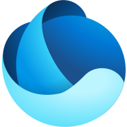 | [OneLake](./icons--0-1/onelake--694-3451.svg) | Icons | Vector | [Source](https://www.figma.com/design/Dc9hrEER6fgmrXVmOIImJT?node-id=694%3A3451) |
| 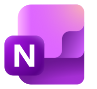 | [OneNote](./icons--0-1/onenote--28-120287.svg) | Icons | Vector | [Source](https://www.figma.com/design/Dc9hrEER6fgmrXVmOIImJT?node-id=28%3A120287) |
|  | [Outlook](./icons--0-1/outlook--28-120295.svg) | Icons | Includes raster image | [Source](https://www.figma.com/design/Dc9hrEER6fgmrXVmOIImJT?node-id=28%3A120295) |
|  | [Outlook\_B&amp;W](./icons--0-1/outlook-b-w--694-3464.svg) | Icons | Vector | [Source](https://www.figma.com/design/Dc9hrEER6fgmrXVmOIImJT?node-id=694%3A3464) |
|  | [People](./icons--0-1/people--108-947.svg) | Icons | Vector | [Source](https://www.figma.com/design/Dc9hrEER6fgmrXVmOIImJT?node-id=108%3A947) |
| 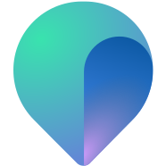 | [Places](./icons--0-1/places--710-53.svg) | Icons | Vector | [Source](https://www.figma.com/design/Dc9hrEER6fgmrXVmOIImJT?node-id=710%3A53) |
|  | [Planner](./icons--0-1/planner--108-49.svg) | Icons | Vector | [Source](https://www.figma.com/design/Dc9hrEER6fgmrXVmOIImJT?node-id=108%3A49) |
| 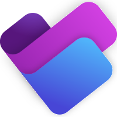 | [Planner](./icons--0-1/planner--686-149.svg) | Icons | Vector | [Source](https://www.figma.com/design/Dc9hrEER6fgmrXVmOIImJT?node-id=686%3A149) |
|  | [PowerApps\_scalable](./icons--0-1/powerapps-scalable--27-610.svg) | Icons | Vector | [Source](https://www.figma.com/design/Dc9hrEER6fgmrXVmOIImJT?node-id=27%3A610) |
|  | [PowerAutomate\_scalable](./icons--0-1/powerautomate-scalable--27-609.svg) | Icons | Vector | [Source](https://www.figma.com/design/Dc9hrEER6fgmrXVmOIImJT?node-id=27%3A609) |
|  | [PowerBI\_scalable](./icons--0-1/powerbi-scalable--27-611.svg) | Icons | Vector | [Source](https://www.figma.com/design/Dc9hrEER6fgmrXVmOIImJT?node-id=27%3A611) |
|  | [PowerFx\_scalable](./icons--0-1/powerfx-scalable--27-614.svg) | Icons | Vector | [Source](https://www.figma.com/design/Dc9hrEER6fgmrXVmOIImJT?node-id=27%3A614) |
|  | [PowerPages\_scalable](./icons--0-1/powerpages-scalable--27-612.svg) | Icons | Vector | [Source](https://www.figma.com/design/Dc9hrEER6fgmrXVmOIImJT?node-id=27%3A612) |
|  | [PowerPlatform\_scalable](./icons--0-1/powerplatform-scalable--27-608.svg) | Icons | Vector | [Source](https://www.figma.com/design/Dc9hrEER6fgmrXVmOIImJT?node-id=27%3A608) |
|  | [PowerPoint](./icons--0-1/powerpoint--28-120288.svg) | Icons | Vector | [Source](https://www.figma.com/design/Dc9hrEER6fgmrXVmOIImJT?node-id=28%3A120288) |
|  | [PowerVirtualAgents\_scalable](./icons--0-1/powervirtualagents-scalable--27-616.svg) | Icons | Vector | [Source](https://www.figma.com/design/Dc9hrEER6fgmrXVmOIImJT?node-id=27%3A616) |
|  | [Priva](./icons--0-1/priva--690-2975.svg) | Icons | Vector | [Source](https://www.figma.com/design/Dc9hrEER6fgmrXVmOIImJT?node-id=690%3A2975) |
|  | [Product\_Insights\_\_scalable](./icons--0-1/product-insights-scalable--28-120315.svg) | Icons | Vector | [Source](https://www.figma.com/design/Dc9hrEER6fgmrXVmOIImJT?node-id=28%3A120315) |
|  | [ProductVisualize\_scalable](./icons--0-1/productvisualize-scalable--28-120330.svg) | Icons | Vector | [Source](https://www.figma.com/design/Dc9hrEER6fgmrXVmOIImJT?node-id=28%3A120330) |
|  | [Project](./icons--0-1/project--28-120291.svg) | Icons | Vector | [Source](https://www.figma.com/design/Dc9hrEER6fgmrXVmOIImJT?node-id=28%3A120291) |
|  | [ProjectOperations\_scalable](./icons--0-1/projectoperations-scalable--28-120314.svg) | Icons | Vector | [Source](https://www.figma.com/design/Dc9hrEER6fgmrXVmOIImJT?node-id=28%3A120314) |
|  | [ProjectServiceAutomation\_scalable](./icons--0-1/projectserviceautomation-scalable--28-120313.svg) | Icons | Vector | [Source](https://www.figma.com/design/Dc9hrEER6fgmrXVmOIImJT?node-id=28%3A120313) |
|  | [Purview](./icons--0-1/purview--690-3010.svg) | Icons | Vector | [Source](https://www.figma.com/design/Dc9hrEER6fgmrXVmOIImJT?node-id=690%3A3010) |
|  | [RemoteAssist\_scalable](./icons--0-1/remoteassist-scalable--28-120329.svg) | Icons | Vector | [Source](https://www.figma.com/design/Dc9hrEER6fgmrXVmOIImJT?node-id=28%3A120329) |
|  | [Sales\_scalable](./icons--0-1/sales-scalable--28-120311.svg) | Icons | Vector | [Source](https://www.figma.com/design/Dc9hrEER6fgmrXVmOIImJT?node-id=28%3A120311) |
|  | [SalesInsights\_scalable](./icons--0-1/salesinsights-scalable--28-120310.svg) | Icons | Vector | [Source](https://www.figma.com/design/Dc9hrEER6fgmrXVmOIImJT?node-id=28%3A120310) |
|  | [Sharepoint](./icons--0-1/sharepoint--28-120299.svg) | Icons | Vector | [Source](https://www.figma.com/design/Dc9hrEER6fgmrXVmOIImJT?node-id=28%3A120299) |
|  | [Stream](./icons--0-1/stream--28-120293.svg) | Icons | Includes raster image | [Source](https://www.figma.com/design/Dc9hrEER6fgmrXVmOIImJT?node-id=28%3A120293) |
|  | [SupplyChainManagement\_scalable](./icons--0-1/supplychainmanagement-scalable--28-120312.svg) | Icons | Vector | [Source](https://www.figma.com/design/Dc9hrEER6fgmrXVmOIImJT?node-id=28%3A120312) |
|  | [SustainabilityCalculator\_scalable](./icons--0-1/sustainabilitycalculator-scalable--28-120309.svg) | Icons | Vector | [Source](https://www.figma.com/design/Dc9hrEER6fgmrXVmOIImJT?node-id=28%3A120309) |
|  | [Sway](./icons--0-1/sway--108-96.svg) | Icons | Vector | [Source](https://www.figma.com/design/Dc9hrEER6fgmrXVmOIImJT?node-id=108%3A96) |
|  | [Synapse Data](./icons--0-1/synapse-data--694-3450.svg) | Icons | Vector | [Source](https://www.figma.com/design/Dc9hrEER6fgmrXVmOIImJT?node-id=694%3A3450) |
|  | [Synapse Data Engineering](./icons--0-1/synapse-data-engineering--694-3448.svg) | Icons | Vector | [Source](https://www.figma.com/design/Dc9hrEER6fgmrXVmOIImJT?node-id=694%3A3448) |
|  | [Synapse Data Warehouse](./icons--0-1/synapse-data-warehouse--694-3447.svg) | Icons | Vector | [Source](https://www.figma.com/design/Dc9hrEER6fgmrXVmOIImJT?node-id=694%3A3447) |
|  | [Synapse Real Time Analytics](./icons--0-1/synapse-real-time-analytics--694-3446.svg) | Icons | Vector | [Source](https://www.figma.com/design/Dc9hrEER6fgmrXVmOIImJT?node-id=694%3A3446) |
|  | [Talent\_scalable](./icons--0-1/talent-scalable--28-120308.svg) | Icons | Vector | [Source](https://www.figma.com/design/Dc9hrEER6fgmrXVmOIImJT?node-id=28%3A120308) |
|  | [TalentAttract\_scalable](./icons--0-1/talentattract-scalable--28-120307.svg) | Icons | Vector | [Source](https://www.figma.com/design/Dc9hrEER6fgmrXVmOIImJT?node-id=28%3A120307) |
|  | [TalentOnboard\_scalable](./icons--0-1/talentonboard-scalable--28-120306.svg) | Icons | Vector | [Source](https://www.figma.com/design/Dc9hrEER6fgmrXVmOIImJT?node-id=28%3A120306) |
|  | [Teams](./icons--0-1/teams--28-120297.svg) | Icons | Vector | [Source](https://www.figma.com/design/Dc9hrEER6fgmrXVmOIImJT?node-id=28%3A120297) |
|  | [Teams\_B&amp;W](./icons--0-1/teams-b-w--694-6346.svg) | Icons | Vector | [Source](https://www.figma.com/design/Dc9hrEER6fgmrXVmOIImJT?node-id=694%3A6346) |
|  | [To Do](./icons--0-1/to-do--108-150.svg) | Icons | Vector | [Source](https://www.figma.com/design/Dc9hrEER6fgmrXVmOIImJT?node-id=108%3A150) |
|  | [Viva Amplify](./icons--0-1/viva-amplify--3-3640.svg) | Icons | Vector | [Source](https://www.figma.com/design/Dc9hrEER6fgmrXVmOIImJT?node-id=3%3A3640) |
|  | [Viva Connections](./icons--0-1/viva-connections--3-3634.svg) | Icons | Vector | [Source](https://www.figma.com/design/Dc9hrEER6fgmrXVmOIImJT?node-id=3%3A3634) |
|  | [Viva Engage](./icons--0-1/viva-engage--3-3633.svg) | Icons | Vector | [Source](https://www.figma.com/design/Dc9hrEER6fgmrXVmOIImJT?node-id=3%3A3633) |
|  | [Viva Glint](./icons--0-1/viva-glint--403-15.svg) | Icons | Vector | [Source](https://www.figma.com/design/Dc9hrEER6fgmrXVmOIImJT?node-id=403%3A15) |
|  | [Viva Goals](./icons--0-1/viva-goals--3-3638.svg) | Icons | Vector | [Source](https://www.figma.com/design/Dc9hrEER6fgmrXVmOIImJT?node-id=3%3A3638) |
|  | [Viva Insights](./icons--0-1/viva-insights--3-3635.svg) | Icons | Vector | [Source](https://www.figma.com/design/Dc9hrEER6fgmrXVmOIImJT?node-id=3%3A3635) |
|  | [Viva Learning](./icons--0-1/viva-learning--3-3637.svg) | Icons | Vector | [Source](https://www.figma.com/design/Dc9hrEER6fgmrXVmOIImJT?node-id=3%3A3637) |
|  | [Viva Pulse](./icons--0-1/viva-pulse--3-3641.svg) | Icons | Includes raster image | [Source](https://www.figma.com/design/Dc9hrEER6fgmrXVmOIImJT?node-id=3%3A3641) |
|  | [Viva Suite](./icons--0-1/viva-suite--3-3632.svg) | Icons | Vector | [Source](https://www.figma.com/design/Dc9hrEER6fgmrXVmOIImJT?node-id=3%3A3632) |
|  | [VoiceAssistant\_scalable](./icons--0-1/voiceassistant-scalable--28-120328.svg) | Icons | Vector | [Source](https://www.figma.com/design/Dc9hrEER6fgmrXVmOIImJT?node-id=28%3A120328) |
|  | [Windows 11](./icons--0-1/windows-11--545-73.svg) | Icons | Vector | [Source](https://www.figma.com/design/Dc9hrEER6fgmrXVmOIImJT?node-id=545%3A73) |
|  | [Word](./icons--0-1/word--28-120290.svg) | Icons | Includes raster image | [Source](https://www.figma.com/design/Dc9hrEER6fgmrXVmOIImJT?node-id=28%3A120290) |
